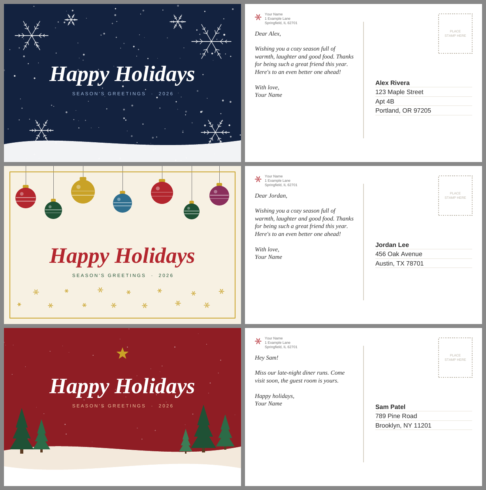

# Holiday cards

Makes printable holiday postcards from a list of friends. Each card has an
illustrated front, and a back with a personal note on the left and the friend's
address on the right.



## Quick start

```bash
cp friends.example.csv friends.csv    # then fill in your friends
python3 postcards.py friends.csv      # writes out/postcards.pdf
```

You need Python 3.11+ and `reportlab` (`pip install reportlab`).

## Your friends list (`friends.csv`)

| column     | required | notes |
|------------|----------|-------|
| `name`     | yes      | full name. The first word is used as `{first_name}` |
| `address1` | yes      | street address |
| `address2` |          | apartment or unit |
| `city`, `state`, `zip` | yes | |
| `country`  |          | printed only when it isn't the US |
| `message`  |          | a custom note for this friend (write `\n` for a line break) |
| `theme`    |          | `snow`, `ornaments` or `pines` |

`friends.csv` is in `.gitignore` so your friends' addresses stay out of git.

## Your settings (`config.toml`)

Set your name, return address, greeting, year and the default message there.
Messages can use `{first_name}`, `{name}` and `{sender}`.

## Options

```
--theme snow|ornaments|pines|mix   front design (default: mix, which rotates)
-o PATH                            output PDF (default: out/postcards.pdf)
-c PATH                            config file (default: config.toml)
```

## Printing

- Each page is 6 × 4 in, the standard USPS postcard size. Pages go front, back,
  front, back.
- Print double-sided on 4×6 card stock (about 110 lb / 300 gsm), with
  **flip on short edge** and the scale set to 100%. Print one test card first.
- The bottom 5/8 in of the address side is left blank for the USPS barcode.
- A 6 × 4 card can go out with a postcard stamp.
